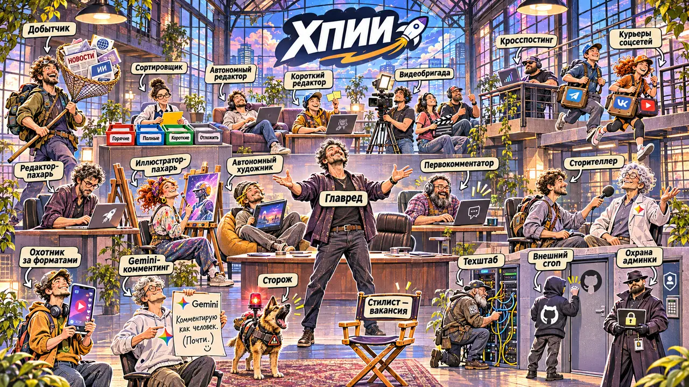

# ХПИИ — штатное расписание цифровой редакции

> **«Хроники Пикирующего ИИ» · 20 ноября 2026 года**  
> *Неофициальная оргструктура издательского дома. Названия должностей шуточные, обязанности вполне настоящие.*  
> Начиналось всё с кросспостинга Дзена в Telegram. Потом выяснилось, что небольшому новостному проекту срочно нужны редакция, художники, курьеры, разведка, техподдержка и сторожевой пёс.



*Вот она, вся наша цифровая гоп-компания: редакторы, художники, разведка, курьеры, техштаб, сторож и приглашённые специалисты.*

**Это список ролей и процессов, а не реестр отдельных людей или гарантированно работающих в данный момент задач.** Один и тот же инструмент может исполнять несколько функций; некоторые роли — отдельные чаты ChatGPT, другие — автоматизации, GitHub Actions или внешние подрядчики. Здесь не хранятся логины, ключи или секреты.

Условные пометки: **в строю** — используется в текущем процессе; **на полставки** — автономный/ограниченный режим; **направление** — работа распределена между инструментами и людьми; **приглашённый** — внешний помощник или сервис; **на паузе** — временно не используется; **задумка** — пока не внедрено. Пометка не заменяет проверки реального запуска.

## Главный кабинет

| Кто | Прозвище / должность | Что делает | Положение |
|---|---|---|---|
| Главред | **Начальник всей этой богадельни** | Выбирает сюжеты, правит тексты, говорит «берём», решает, что и когда выпускать; оплачивает праздник жизни своим временем | В строю, без выходных по версии коллектива |

## Редакция, разведка и производство текста

| Кто | Прозвище / должность | Что делает | Положение |
|---|---|---|---|
| Добытчик новостей | **Разведчик с бездонным мешком** | Находит новые ИИ-события, приносит сырьё в общий пул | В строю |
| Утренний сортировщик | **Санитар новостного склада** | Проверяет весь свободный пул, выделяет горячие, полные, короткие, связки, отсрочку и мусор; применяет решения **только после утверждения** | В строю |
| Основной редактор | **Пахарь-редактор** | Проверяет факты, пишет полноценные материалы, готовит статьи для сайта и Дзена, сопутствующие тексты, перелинковку | В строю |
| Автономный редактор | **Халявщик на полставки № 1** | Самостоятельно готовит редакционные комплекты в контролируемом режиме, не заменяет утверждение главреда | На полставки |
| Редактор «Новости коротко» | **Короткостволист** | Забирает собственную очередь, готовит до пяти отдельных коротких заметок на вычитку; сам не утверждает публикацию | В строю |
| Первокомментатор | **Поджигатель обсуждений** | Пишет первый авторский комментарий под собственными статьями ХПИИ в Дзене — живой, без пересказа статьи | В строю как отдельная редакционная роль |
| Автор историй успеха с ИИ | **Журналюга-сторителлер, стажёр, ёпта** | Ищет человеческий сюжет, заработки, конкретные цифры и необычный опыт применения ИИ; учится не писать протокол допроса | Стажировка |
| Литературный редактор-стилист | **Будущий борец с нейроканцеляритом** | После фактчекинга перерабатывает сухой черновик: композиция, голос ХПИИ, живой язык без выдуманных деталей | **Задумка; не нанят** |

## Художественный отдел и видеоцех

| Кто | Прозвище / должность | Что делает | Положение |
|---|---|---|---|
| Основной художник | **Пахарь-иллюстратор** | Делает авторские обложки и следит, чтобы они не превращались в бесконечную серию одинаковых роботов | В строю |
| Автономный художник | **Халявщик на полставки № 2** | Создаёт кандидаты обложек для проверки, не публикуя статьи | На полставки |
| Охотник за форматами | **Следопыт вирусных роликов** | Исследует Shorts/Reels и выясняет, какие приёмы можно применить к видеосюжетам ХПИИ | В строю как аналитическая задача |
| Видеопроизводство | **Съёмочная бригада без павильона** | Сценарии, голоса, визуальные материалы, монтаж, субтитры и выпуск видео; это совокупность функций, не один штатный агент | Направление |
| Еженедельный видеообзор | **Будущая воскресная редакция** | Горизонтальный выпуск с наиболее цепляющими новостями недели | Задумка, в копилке идей |

## Доставка, продвижение и вечная борьба с цифрами

| Кто | Прозвище / должность | Что делает | Положение |
|---|---|---|---|
| Старый чат «Кросспостинг» | **Ветеран-основатель, редакционный собеседник** | Когда-то запускал доставку из Дзена; теперь обсуждает стратегию, статистику, эксперименты и периодически грустит над охватами | В строю |
| Курьеры соцсетей | **Отдел «Разнести по адресам»** | Конвейеры доставки в Telegram, VK, Threads, X и другие подключённые направления. У каждого канала свои ограничения и возможные сбои | Технические процессы; состояние каждого канала отдельно |
| Дзен | **Ручной фельдъегерь главреда** | Подготовленные материалы для Дзена пока ставятся вручную; это не отдельный автономный сотрудник | Ручной участок |
| Instagram | **Курьер на перекуре** | Направление кросспостинга сохранено, обычные публикации ранее поставлены на паузу | На паузе |
| Аналитика площадок | **Счётная палата с грустными глазами** | Смотрит просмотры, охваты, удержание и прирост подписчиков; помогает решать, что работает | Направление |
| Комментинг на чужих площадках | **Отдел разговоров с соседями** | Мониторит подходящие публикации других медиа, подготавливает содержательные комментарии; публикация и выбор зависят от действующего процесса | В строю / с ручным контролем |

## Техштаб, сторожа и инфраструктура

| Кто | Прозвище / должность | Что делает | Положение |
|---|---|---|---|
| Технический штаб | **Бородатый сисадмин-многостаночник** | Сайт, админка, очереди, GitHub, отладка и спасение конвейера, когда что-то опять пошло не так | В строю |
| Сторож | **Лает на ошибки и подвисшие очереди** | Независимо проверяет серьёзные сбои, зависшие релизы и неисправности; сигналит, но сам не публикует | В строю |
| Планировщик публикаций | **Диспетчер стрелок и часов** | Следит за слотами, приоритетом и ночной паузой сайта | Технический процесс |
| GitHub Actions и выпускающий конвейер | **Типография с автоматическими воротами** | Собирает сайт, проверяет материалы, формирует релизы и обслуживает отдельные очереди | Технический процесс |
| Внешний cron | **Вышибала, который будит GitHub** | Внешняя подстраховка запусков/расписаний, о которой сообщил главред | Внешний технический процесс; параметры проверяются отдельно |

## Приглашённые специалисты и аутсорс

| Кто | Прозвище / должность | Что делает | Положение |
|---|---|---|---|
| Gemini для комментинга | **Приглашённый остроумец** | Помогает готовить комментарии и обрабатывать материалы для комментинга; требует человеческого контроля точности и интонации | Приглашённый |
| Специалисты по комментингу | **Один пашет, другой рулит** | Развивают механизм подбора источников, карточек и редакторского процесса комментинга | Специальный проект |
| Специалисты авторского клуба | **Строители клуба взаимопомощи авторов** | Проектируют отдельный MVP с профилями, заданиями и историей действий | Специальный проект / MVP |
| Внешняя служба авторизации | **Спецслужба-аутсорс, охрана админки** | Помогает с доступом и авторизацией административных функций; не хранить здесь детали доступа | Приглашённые специалисты |
| Прочие технические приглашённые | **Десант на конкретную задачу** | Подключаются к отдельным инструментам и возможностям, когда штатный техштаб занят | По необходимости |

## Новые направления редакции

- **«Сделано с ИИ»** — согласованное название пятой рубрики о необычных пользовательских проектах; внедрение сайта поручено техштабу. Новостной кандидат №376 — возможный первый материал.
- **Литературный редактор-стилист** — потенциальная новая должность между основным редактором и главредом. Сначала нужен стиль, примеры удачных правок и проверка на реальных статьях; никаких самостоятельных изменений уже утверждённого текста.
- **Видеоцех и еженедельные обзоры** — отдельное направление роста, а не доказательство наличия ещё десятка автономных сотрудников.

## Схема движения одного обычного материала

```text
Добытчик → Пул → Сортировщик
                    ├─ горячая / полная → Основной или автономный редактор
                    ├─ короткая         → Короткий редактор
                    ├─ объединение      → Ведущий сюжет + сохранённые источники
                    └─ удержание        → Ждёт проверки или решения главреда

Текст → Главред («берём») → Художник / кандидат обложки
     → Очередь сайта → Выпуск → Каналы доставки / ручной Дзен
                                      ↓
                           Аналитика, комментарии
                     
Сторож и техштаб — сбоку, со свистком и огнетушителем.
```

## Сверка с технической документацией

- [Утренний сортировщик](BRIEFS_MORNING_TRIAGE_AGENT.md) и [маршрутизация](EDITORIAL_TRIAGE_ROUTING.md)
- [Короткий редактор](BRIEFS_EDITOR_AGENT.md)
- [Автономный редактор](AUTO_EDITOR_AUTONOMOUS_AGENT.md)
- [Автономный художник](ARTIST_AUTONOMOUS_AGENT.md)
- [Комментинг](COMMENTING_QUEUE.md)
- [Охотник за форматами](SHORTS_FORMAT_HUNTER.md) и [видеопроизводство](HPII_VIDEO_PRODUCTION.md)
- [Рубрика «Сделано с ИИ»](RUBRIC_MADE_WITH_AI.md)
- [Копилка идей](ideas/README.md)

---

*Бухгалтерия штат пока не посчитала. Если считать каждый workflow и каждого курьера отдельно, придётся нанимать ещё и кадровика. А ему — отдельного проверяющего.*
